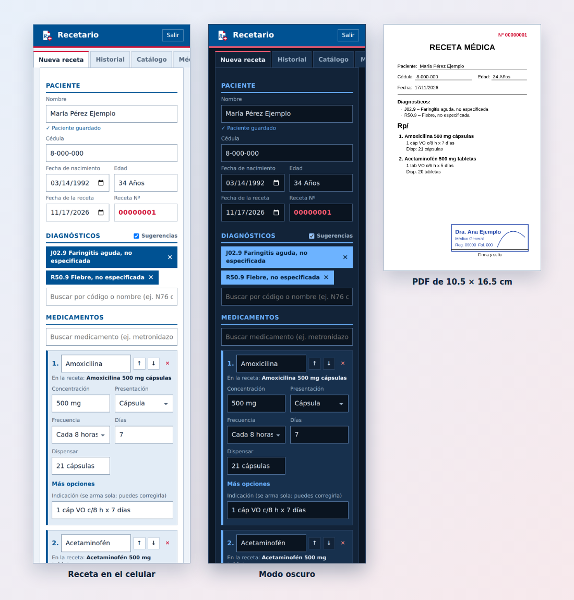

<h1 align="center">Recetario</h1>

<b>Recetas médicas en PDF de 10.5 × 16.5 cm, listas para imprimir.</b> 
Escribes el nombre del paciente; el resto se completa solo.

  
  

---

## ✨ Qué hace

| | |
|---|---|
| 🧑‍⚕️ **Pacientes guardados** | Escribes el nombre y propone los que ya existen (cédula, nacimiento, edad). Si es nuevo, se guarda solo. |
| 🩺 **Diagnósticos con código CIE-10** | Búsqueda por código o nombre (`N76`, `vaginitis`). Lo que más usas sale primero. |
| 💊 **Medicamentos con formato estándar** | Principio activo + concentración + presentación (tableta, cápsula, ampolla, jarabe, gotas, crema…). El nombre completo se arma solo: *«Acetaminofén 500 mg tabletas»*. |
| 🧮 **Indicación y cantidad automáticas** | Eliges **«cada N» + hora, día, semana, mes o año** y **«durante N» + días, semanas o meses**; sale *«1 tab VO c/6 h x 5 días»* y *«Disp: 20 tabletas»*, con las tomas por día calculadas. También «dosis única» con repetición (*«repetir a las 72 h»*). Todo se puede corregir a mano. |
| 🔁 **Sugerencias en los dos sentidos** | Plegadas por defecto («Ver medicamentos sugeridos»). Con un diagnóstico propone medicamentos y con un medicamento propone diagnósticos, mezclando: **lo que tú has recetado** (aprende de cada receta), **Wikidata** (relaciones universales fármaco ↔ código CIE-10, CC0) y los formularios oficiales de Panamá y Uruguay. Se pueden apagar. |
| 🖋️ **Sello y firma** | Subes el sello: si es un PNG con transparencia se respeta tal cual; si tiene fondo blanco (foto o escaneo) se le quita el blanco. Sale sobre la línea «Firma y sello»; sin sello, la línea queda en blanco para firmar y sellar a mano. |
| 🧬 **Esquemas especiales** | **Fases** («1 cáp c/72 h x 7 días, luego c/7 días x 6 meses», como el fluconazol en candidiasis recurrente), instrucciones frecuentes (*con alimentos*, *si hay dolor*…) y la cantidad a dispensar sumando todas las fases. |
| 🎯 **Pautas prellenadas** | Al elegir un diagnóstico y un medicamento, «cada cuánto» y «por cuánto tiempo» se rellenan con la pauta que un formulario oficial de atención primaria ([CCSS Costa Rica 2008](https://www.binasss.sa.cr/libros/formulario2008.pdf)) da para esa indicación. Se ve la fuente y se puede cambiar; lo que tú ya recetaste tiene prioridad. |
| 🛠️ **Panel de administrador** | La pestaña **Admin** muestra los medicamentos y diagnósticos nuevos que los usuarios escribieron y no están en el catálogo (solo nombres, nunca datos de pacientes), para aprobarlos, corregirlos o descartarlos, y las relaciones diagnóstico ↔ medicamento que se van aprendiendo, para quitar las que estén mal. |
| ✅ **Buenas prácticas** | Avisa si falta la indicación o la cantidad; normaliza números (`.5` → `0.5`, `5.0` → `5`) y usa siempre UI, mcg y mL, como recomiendan ISMP/FDA. |
| ⚡ **Rápido con el teclado** | En cualquier buscador, **Enter** elige la primera sugerencia: paciente, diagnóstico y medicamento sin tocar el mouse. |
| 📤 **Imprimir o enviar** | «Guardar y abrir PDF» para imprimir; «Enviar» abre el menú de compartir del teléfono (correo, WhatsApp…) con el PDF adjunto. |
| 🗂️ **Historial** | Abre, edita, repite con número nuevo o borra recetas anteriores. Número de receta automático (en rojo en el PDF). |
| 📱 **Hecho para el celular** | Campos grandes, modo oscuro y se puede guardar en la pantalla de inicio. Si hay muchos medicamentos, achica la letra o pasa a una segunda hoja. |

## 📚 De dónde salen los datos

Nada clínico viene «de fábrica»:

- **Diagnósticos:** CIE-10 en español ([cayasso/cie10](https://github.com/cayasso/cie10)), con los acentos restaurados por el script.
- **Medicamentos:** [CIMA](https://cima.aemps.es), la base oficial de la AEMPS (España): solo nombre, concentración y forma de los de un solo principio activo. Los nombres se adaptan a uso regional (comprimido → tableta, paracetamol → acetaminofén). Es un catálogo de España: si falta una presentación de tu país, la escribes y queda guardada.
- **Relaciones medicamento ↔ diagnóstico:** [Wikidata](https://www.wikidata.org) (CC0): propiedad «condición médica tratada» de cada fármaco hacia enfermedades con código CIE-10 (`indicaciones_wd.json`). Es colaborativo, así que se filtra a los fármacos de los catálogos; puede tener errores: el médico decide.
- **Sugerencias por indicación (opcional):** [Formulario Oficial de Medicamentos 2007](https://www.gacetaoficial.gob.pa/storage/gacetas/2007/05/25787/4463.pdf) de la Caja de Seguro Social de Panamá y [Formulario Terapéutico de Medicamentos 2012](https://www.gub.uy/ministerio-salud-publica/sites/ministerio-salud-publica/files/documentos/publicaciones/Formulario%20Terap%C3%A9utico%20de%20Medicamentos%20del%202012.pdf) del Ministerio de Salud Pública de Uruguay: solo se usan para saber para qué diagnóstico se indica cada medicamento; no se muestra su texto. Son de 2007 y 2012: no son una guía clínica actual.
- **Dosis, frecuencias y relaciones diagnóstico ↔ medicamento:** no hay. Las pone el médico y la app las aprende de sus recetas.

## 🔒 Privacidad y aviso

Los datos de los pacientes son **información médica sensible**, y por eso quedan en el navegador de cada médico y no en el servidor: baja un respaldo de vez en cuando (pestaña **Sello**). Si lo pones en internet, define `CLAVE` y usa HTTPS; sin `CLAVE` cualquiera con acceso a la página puede usarla y enviar correlaciones al servidor.

Este programa **no es un dispositivo médico** y no sustituye los requisitos legales de tu país (por ejemplo, recetas especiales para medicamentos controlados). El médico es quien decide y firma cada receta. Revisa los nombres y códigos antes de usarlos.

## 🤝 ¿Te interesa?

Este repositorio es una **vitrina**: muestra la idea y cómo se ve, **no incluye el código**. Si eres médico, clínica o institución y quieres una demostración, una instalación propia o una licencia, escríbeme: johnkleverbatista@gmail.com.

## 📄 Licencia

Copyright (c) 2026 John Batista (KleverBatista-max). Todos los derechos reservados. El software no se publica ni se concede permiso para copiarlo, modificarlo, distribuirlo o venderlo.

**English:** a small self-hosted **prescription pad** that builds printable PDF prescriptions (10.5 × 16.5 cm): saved patients, ICD-10 (Spanish) diagnoses, standardized medications and prefilled dosing. This repository is a showcase only; the code is not public. Contact me for a demo or a license.

## Autor

Creado por **John Batista** ([@KleverBatista-max](https://github.com/KleverBatista-max)). Hecho con ayuda de asistentes de IA (ChatGPT, Claude) como herramientas.
